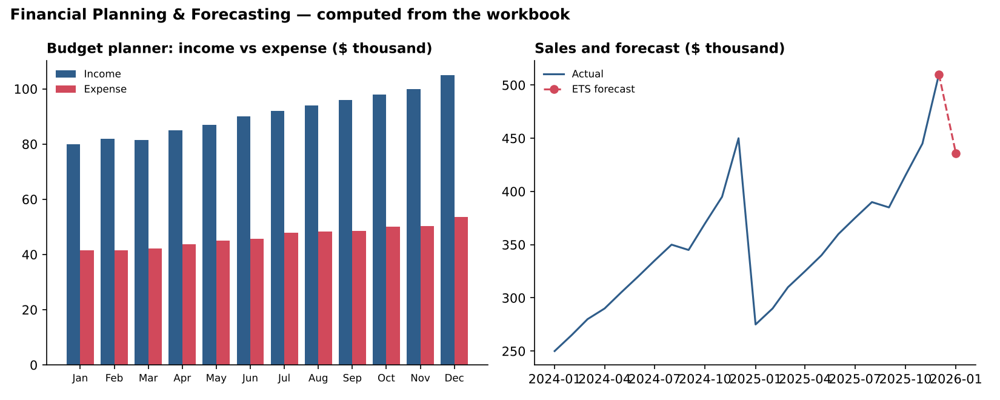

# 📈 Project 4 — Financial Planning & Forecasting

A personal/business finance model that combines budgeting, loan EMIs, investment appraisal, scenario comparison, sales forecasting and an at-a-glance dashboard.

## Brief
> Create an Excel project to manage budgets, calculate loan EMIs, predict future sales, and compare financial plans using Goal Seek, Scenario Manager, Solver, `PMT`, `NPV` and forecasting functions.
> — [project brief](../docs/Basic_to_Advanced_Excel_Projects_Brief.docx)

## Modules
| Sheet | What it does | Key formulas / tools |
|---|---|---|
| **Budget Planner** | 12 months of income vs rent, food, utilities, fuel, entertainment and insurance; monthly savings and savings % | `SUM`, subtraction, conditional formatting |
| **EMI Calculator** | Loan EMI, total payment and interest | `PMT` · **Goal Seek** |
| **Investment Analysis** | Appraises a 5-year cash-flow investment | `NPV`, ROI formula |
| **Scenario Analysis** | Worst / Likely / Best case comparison of income, expenses and EMI | Scenario table |
| **Sales Forecast** | 24 months of sales history and next-month forecast | `FORECAST.ETS`, `EDATE` |
| **Solver Optimization** | Allocation of a 150,000 income across savings, investment and expenses | Solver setup |
| **Dashboard / Dashboard Working** | KPI cards and 8 charts | `ABS`, `TEXT`, `IF` ratios |

## Key results
**Budget (full year)** — income **1,090,500**, expenses **558,000**, savings **532,500** (monthly savings rate 48–50%).

**Loan EMI** — 500,000 at 9% for 5 years:
| | Initial | After Goal Seek |
|---|---|---|
| Loan amount | 500,000 | **481,733.74** |
| EMI | 10,379.18 | **10,000.00** |
| Total interest | 122,750.66 | 118,266.26 |

Goal Seek answers *"what loan can I afford if I want an EMI of exactly 10,000?"*

**Investment** — initial outlay 250,000, cash flows 70K / 85K / 90K / 95K / 100K, discount rate 8% → **NPV = 97,019.67** (positive, so the project adds value) and **ROI = 76%**.

**Scenarios (monthly savings = income − expenses − EMI)**
| Worst | Likely | Best |
|---|---|---|
| −5,000 | 13,000 | 31,000 |

**Forecast** — sales rose from 250,000 (Jan 2024) to 510,000 (Dec 2025). `FORECAST.ETS` projects **435,648 for Jan 2026**, which is 14.6% below the December peak — consistent with the post-December dip visible in the previous year (450,000 → 275,000).

**Dashboard ratios** — debt-to-income and investment-to-income ratios plus an ROI rating ("High Return / Moderate / Low Return").

## Skills demonstrated
`PMT` · `NPV` · `FORECAST.ETS` · `EDATE` · Goal Seek · Solver · scenario analysis · financial KPIs · chart-based dashboard

## How to use
Open `Financial_Planning_and_Forecasting.xlsx` in Excel 365/2021+. Change the budget inputs, loan rate/tenure or discount rate and every dependent KPI and chart updates. To re-run the tools: **Data → What-If Analysis → Goal Seek** (EMI sheet) and **Data → Solver** (enable the Solver add-in first).

---
[← Back to all projects](../README.md)
